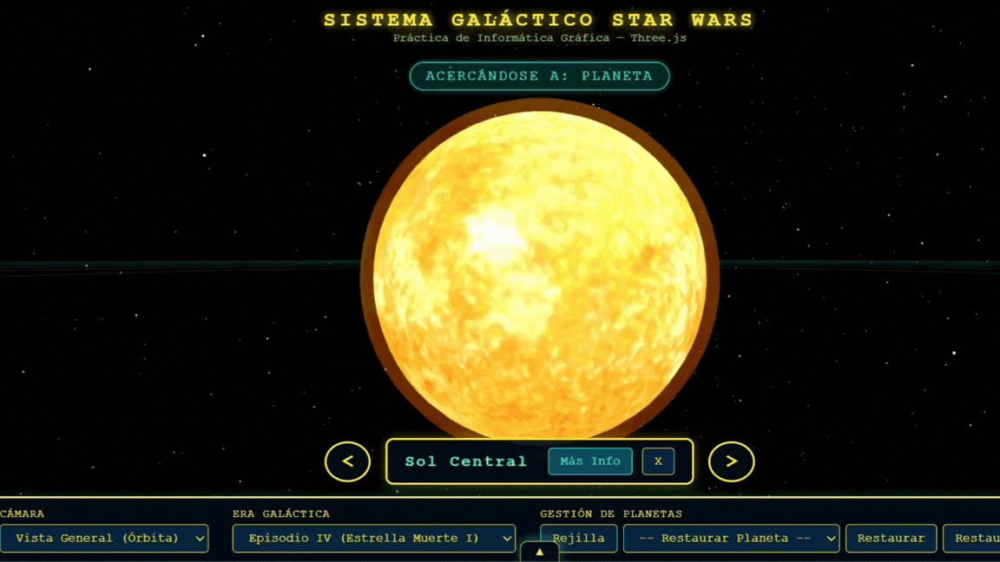
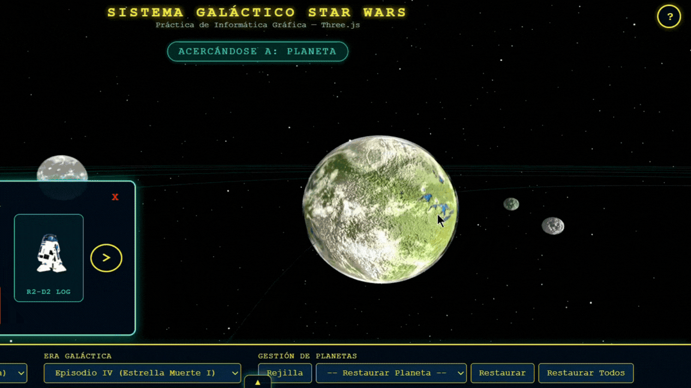
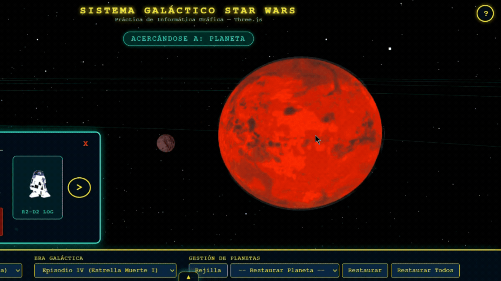
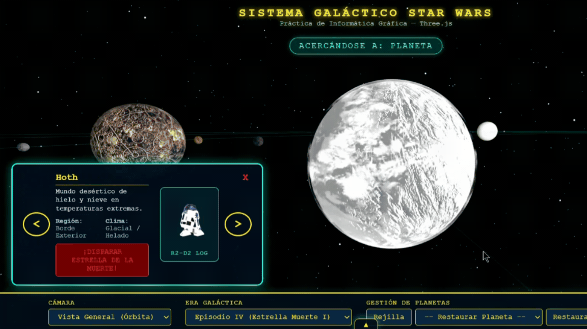
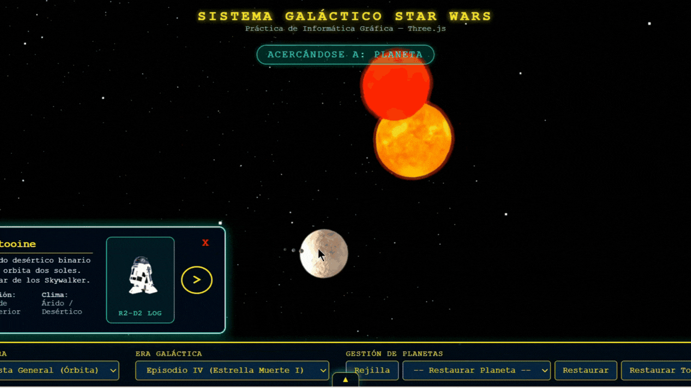

### UNIVERSIDAD DE LAS PALMAS DE GRAN CANARIA
**Grado en Ingeniería Informática — Asignatura: Informática Gráfica**  
*Curso Académico 2026/2027*

---

<h1 style="color: #FFE81F; font-size: 2.2rem; font-weight: bold; letter-spacing: 4px; text-shadow: 0 0 12px rgba(255, 232, 31, 0.6);">
  SISTEMA GALÁCTICO INTERACTIVO STAR WARS
</h1>

<h3 style="color: #00FFE1; font-size: 1.1rem; letter-spacing: 2px;">
  Desarrollado por: <a href="https://github.com/studies-ulpgc" style="color: #00FFE1; text-decoration: none; font-weight: bold;">Dácil Santana Ortega</a>
</h3>

---

## Índice de Contenidos

1. [Resumen del Proyecto](#1-resumen-del-proyecto)
2. [Componentes del Sistema Galáctico](#2-componentes-del-sistema-gal%C3%A1ctico)
3. [Demostraciones en Vídeo y Funcionalidades](#3-demostraciones-en-v%C3%ADdeo-y-funcionalidades)
   - [3.1. Vista General y Control de Rejilla](#31-vista-general-y-control-de-rejilla)
   - [3.2. Paneles Informativos y Navegación entre Astros](#32-paneles-informativos-y-navegaci%C3%B3n-entre-astros)
   - [3.3. Mecánica de Destrucción con la Estrella de la Muerte](#33-mec%C3%A1nica-de-destrucci%C3%B3n-con-la-estrella-de-la-muerte)
   - [3.4. Variante Estacional: Estrella de la Muerte II](#34-variante-estacional-estrella-de-la-muerte-ii)
   - [3.5. Gestión y Restauración de Planetas](#35-gesti%C3%B3n-y-restauraci%C3%B3n-de-planetas)
   - [3.6. Navegación en Modo Nave X-Wing y Sistema de Proximidad](#36-navegaci%C3%B3n-en-modo-nave-x-wing-y-sistema-de-proximidad)
4. [Análisis Técnico de Texturas y Capas Gráficas](#4-an%C3%A1lisis-t%C3%A9cnico-de-texturas-y-capas-gr%C3%A1ficas)
5. [Arquitectura del Proyecto y Comparativa Académica](#5-arquitectura-del-proyecto-y-comparativa-acad%C3%A9mica)
6. [Bibliografía, Fuentes y Colaboradores](#6-bibliograf%C3%ADa-fuentes-y-colaboradores)

---

## 1. Resumen del Proyecto

El presente proyecto consiste en la creación de un **sistema galáctico tridimensional interactivo** ambientado en el universo de *Star Wars*, desarrollado mediante la biblioteca **Three.js** e integrado en un entorno web ejecutable en tiempo real.

La aplicación combina modelado astronómico con mecánicas de simulación interactiva. Permite explorar un sistema planetario completo compuesto por una estrella central, seis planetas principales con sus respectivos satélites, un sistema binario independiente (Tatooine con dos soles y tres lunas) y la estación espacial imperial **Estrella de la Muerte** en dos eras distintas (Episodio IV y Episodio VI).

---

## 2. Componentes del Sistema Galáctico

En la siguiente tabla se detallan los elementos gráficos y modelos tridimensionales que conforman la escena:

| Categoría | Elementos | Ubicación y Detalles Técnicos |
| :--- | :--- | :--- |
| **Estrella Central** | Sol Central | Centro de coordenadas `(0,0,0)` con capa interna de plasma y malla externa de fuego solar con mezcla aditiva. |
| **Planetas Principales** | Naboo, Mustafar, Hoth, Coruscant, Endor y Bespin | Cuerpos orbitales elípticos con materiales Phong, mapas de rugosidad (*bump mapping*) y capas de nubes dinámicas. |
| **Satélites / Lunas** | 18 lunas distribuidas entre los planetas | Mallas jerárquicas vinculadas a los pivotes de los planetas, con trazado visual de sus órbitas en pantalla. |
| **Sistema Binario** | Tatooine (2 Soles + 3 Lunas) | Ubicado en coordenadas remotas `(-260, 50, -300)` con rotación propia, tormenta de arena y sistema solar doble. |
| **Modelos 3D GLTF** | Estrella de la Muerte (Ep. IV / Ep. VI), Caza X-Wing y R2-D2 | Archivos `.glb` cargados dinámicamente mediante `GLTFLoader` desde la carpeta `3D_models/`[^1]. |
| **Sistemas de Interfaz** | Panel de Control, Ventana Flotante de Ayuda y Visor R2-D2 | Paneles HTML/CSS superpuestos con un renderizador secundario e independiente para la vista en directo del androide. |

---

## 3. Demostraciones en Vídeo y Funcionalidades

En esta sección se presentan los vídeos demostrativos de la aplicación, estructurados por módulos funcionales. 

> **Nota sobre el audio:** Los vídeos que incluyen sonido relevante (efectos sonoros del androide R2-D2 y secuencia del superláser) vienen indicados expresamente.

---

### 3.1. Vista General y Control de Rejilla

En este modo de visualización, la cámara orbita libremente alrededor del centro del sistema galáctico mediante controles orbitales interactivos.

https://github.com/user-attachments/assets/3ecd90e3-5b56-4661-a736-08bba8085819

**Funcionalidades mostradas:**
- **Control orbital libre:** Rotación de cámara en 360°, desplazamiento panorámico y ajuste de distancia.
- **Conmutación de rejilla:** Activación y desactivación del asistente plano (*GridHelper*) desde el panel de control.
- **Movimiento orbital:** Traslación elíptica continua e independiente de todos los planetas y satélites.

---

### 3.2. Paneles Informativos y Navegación entre Astros

Al seleccionar cualquier cuerpo celeste con el puntero, se activa el sistema de navegación informativa.

> [!NOTE]
> **Vídeo con audio:** Incluye sonidos originales del androide R2-D2 al seleccionar o conmutar de planeta.

https://github.com/user-attachments/assets/7232c754-d72b-4ae2-a820-470d11ca77d5

**Funcionalidades mostradas:**
- **Barra flotante de resumen:** Muestra el nombre del planeta seleccionado con opciones rápidas de acción.
- **Ficha técnica detallada:** Panel lateral con trasfondo, región y clima del astro.
- **Visor 3D en directo:** Renderizado secundario del androide R2-D2 en la tarjeta informativa.
- **Navegación secuencial:** Transición directa entre planetas mediante botones de desplazamiento (`<` y `>`).

---

### 3.3. Mecánica de Destrucción con la Estrella de la Muerte

Muestra la interacción por proyección de rayos (*raycasting*) para identificar objetivos y desencadenar la secuencia de disparo de la estación espacial.

> [!NOTE]
> **Vídeo con audio:** Contiene los efectos sonoros del disparo del superláser y la detonación del astro.

https://github.com/user-attachments/assets/b0f72643-0732-4221-98d8-f8164b44dfcc

**Funcionalidades mostradas:**
- **Inmovilización del objetivo:** Congelación temporal del movimiento orbital durante el disparo.
- **Identificación de objetivos destructibles:** Secuencia de disparo aplicable a los seis planetas principales.
- **Protección de astros especiales:** Deshabilitación de disparo para el Sol Central, Tatooine y la propia estación espacial.

---

### 3.4. Variante Estacional: Estrella de la Muerte II

Demostración de la conmutación de modelos tridimensionales en tiempo real para representar la estación espacial en su fase de construcción (Episodio VI).

https://github.com/user-attachments/assets/348eb0c2-d7de-4275-8d51-31c2cdbaaa69

**Funcionalidades mostradas:**
- **Intercambio dinámico de geometrías:** Sustitución asíncrona entre los modelos `.glb` de la Estrella de la Muerte I y II.
- **Mantenimiento de la jerarquía:** Conservación de los puntos de origen del superláser y la detección de impacto.

---

### 3.5. Gestión y Restauración de Planetas

Demostración de la gestión de inventario de astros tras ser eliminados de la escena.

https://github.com/user-attachments/assets/e29f9b74-e8b7-4193-9584-443b99cc6ccc

**Funcionalidades mostradas:**
- **Lista dinámica de selección:** Actualización del desplegable con los astros destruidos.
- **Restauración individual y global:** Opciones para recuperar planetas específicos o reactivar la totalidad del sistema.

---

### 3.6. Navegación en Modo Nave X-Wing y Sistema de Proximidad

Cambio de perspectiva hacia la vista subjetiva en tercera persona para pilotar la caza X-Wing por el espacio tridimensional.

https://github.com/user-attachments/assets/fdfa2066-8abf-4432-906c-7f3349a2c45b

**Funcionalidades mostradas:**
- **Guía de controles:** Ventana emergente con instrucciones de vuelo (W, A, S, D, Q, E).
- **Control cinemático:** Vuelo libre con seguimiento de cámara.
- **Aviso táctico de proximidad:** Detección por distancia tridimensional en tiempo real al aproximarse a cuerpos celestes.

---

## 4. Análisis Técnico de Texturas y Capas Gráficas

En esta sección se analiza en detalle la configuración gráfica de los astros del sistema, haciendo uso de bucles animados cortos (GIFs) para apreciar las propiedades ópticas, mapas de relieve y capas atmosféricas.

---

### 4.1. Configuración de Materiales e Iluminación

Todos los planetas del sistema utilizan el material `MeshPhongMaterial` para reaccionar a la iluminación de la escena (simulada mediante fuentes direccionales y ambientales):

- **Mapas de color/difusos (`map`):** Textura base de la superficie planetaria.
- **Mapas de rugosidad (*bump mapping*, `bumpMap`):** Relieve tridimensional simulado mediante cálculo de normales (`bumpScale`).
- **Efecto de emisión térmica (`emissive`):** Intensidad lumínica propia (`0.6`) aplicada en Mustafar para simular la lava incandescentes.

---

### 4.2. Galería Técnica de Astros y Capas Atmosféricas

| Astro / Planeta | Vista en Detalle | Configuración Técnica de Capas y Materiales |
| :--- | :---: | :--- |
| **Sol Central y Fuego Solar** |  | Malla central combinada con una segunda esfera concéntrica exterior (`sun_fire`) animada en rotación inversa con transparencia aditiva (`AdditiveBlending`). |
| **Naboo (Planeta + Lunas)** |  | Superficie acuática, capa de nubes translúcidas (`opacity: 0.35`) y tres satélites en órbitas independientes con sus trayectorias trazadas. |
| **Mustafar (Mundo Volcánico)** |  | Mapa de rugosidad elevado (`bumpScale: 2.5`), emisión roja base y capa de ceniza volcánica (`MeshStandardMaterial`). |
| **Hoth (Glacial)** |  | Brillo especular alto (`shininess: 80`) para simular hielo y capa de nubes de nieve. |
| **Sistema Binario Tatooine** |  | Sistema con dos soles, tres lunas y una capa superior en rotación que simula una **tormenta de arena** global. |

---

### 4.3. Estrategia de Optimización de Capas de Nubes

Para garantizar un rendimiento fluido en el navegador, se aplicaron las siguientes estrategias de optimización:

1. **Reutilización de mapas de transparencia:** Se empleó la misma textura de nubes (`earthcloudmaptrans_invert.jpg`) en Naboo, Mustafar y Hoth.
2. **Diferenciación mediante propiedades del material:** Se varió el color (`color`), la opacidad (`opacity`) y la mezcla (*blend mode*) según el planeta:
   - **Mustafar:** Nubes de ceniza oscurecidas (`color: 0x111111`, `opacity: 0.85`).
   - **Hoth:** Tormenta de nieve (`opacity: 0.4`).

---

## 5. Arquitectura del Proyecto y Comparativa Académica

En esta sección se detalla la estructura modular de archivos del proyecto y la equivalencia técnica respecto a las prácticas realizadas.

---

### 5.1. Estructura de Módulos y Organización de Archivos

<pre><b>IG_Semana_6_7/</b>
├── <a href="./3D_models/">3D_models/</a>                    # Modelos tridimensionales en formato .glb
│   ├── <a href="./3D_models/death_star.glb">death_star.glb</a>            # Modelo Estrella de la Muerte (Episodio IV)
│   ├── <a href="./3D_models/death_star_ii.glb">death_star_ii.glb</a>         # Modelo Estrella de la Muerte II (Episodio VI)
│   ├── <a href="./3D_models/x-wing-fighter.glb">x-wing-fighter.glb</a>                 # Modelo caza estelar X-Wing
│   └── <a href="./3D_models/r2d2.glb">r2d2.glb</a>                  # Modelo androide R2-D2
├── <a href="./readme_media/">readme_media/</a>                 # Recursos multimedia de la documentación
│   ├── <a href="./readme_media/assets/">assets/</a>                   # Logotipo institucional
│   ├── <a href="./readme_media/demos/">demos/</a>                    # Vídeos demostrativos
│   └── <a href="./readme_media/shorts/">shorts/</a>                   # Animaciones en formato GIF
├── <a href="./src/">src/</a>                          # Código fuente de la aplicación
│   ├── <a href="./src/assets/textures/">assets/textures/</a>          # Texturas de superficies y nubes
│   ├── <a href="./src/config/">config/</a>
│   │   └── <a href="./src/config/planetData.js">planetData.js</a>         # Datos físicos y de configuración de los astros
│   ├── <a href="./src/modules/">modules/</a>
│   │   ├── <a href="./src/modules/controlsManager.js">controlsManager.js</a>    # Controladores de cámara (Órbita y Nave)
│   │   ├── <a href="./src/modules/deathStar.js">deathStar.js</a>          # Lógica de la estación imperial y disparo láser
│   │   ├── <a href="./src/modules/modelLoader.js">modelLoader.js</a>        # Carga asíncrona de modelos 3D
│   │   ├── <a href="./src/modules/planetBuilder.js">planetBuilder.js</a>      # Construcción de geometrías, materiales y órbitas
│   │   ├── <a href="./src/modules/r2d2Viewer.js">r2d2Viewer.js</a>         # Renderizador secundario para el visor R2-D2
│   │   ├── <a href="./src/modules/raycasterManager.js">raycasterManager.js</a>   # Proyección de rayos, interacción y avisos de proximidad
│   │   └── <a href="./src/modules/sceneSetup.js">sceneSetup.js</a>         # Configuración base de la escena WebGL
│   ├── <a href="./src/index.html">index.html</a>                # Estructura del documento e interfaz
│   ├── <a href="./src/main.js">main.js</a>                   # Punto de entrada y bucle principal de animación
│   └── <a href="./src/styles.css">styles.css</a>                # Hojas de estilo de la interfaz
├── <a href="./package.json">package.json</a>                  # Configuración del proyecto y dependencias
└── <a href="./README.md">README.md</a>                     # Documentación principal
</pre>

---

### 5.2. Scripts de Clase y Entornos CodeSandbox

Correspondencia técnica entre los ejemplos de clase ([`otsedom`](https://github.com/otsedom)) y su implementación en el proyecto:

- **CodeSandbox Semana 6:** [ig-s6-xtdjrm](https://codesandbox.io/p/sandbox/ig-s6-xtdjrm)
- **CodeSandbox Semana 7:** [ig-s7-36r8mq](https://codesandbox.io/p/sandbox/ig-s7-36r8mq?file=%2Fsrc%2Findex.html)

| Script de Referencia | Concepto Base | Aplicación en el Proyecto |
| :--- | :--- | :--- |
| **[`script01`](https://codesandbox.io/p/sandbox/ig-s6-xtdjrm) / [`script02`](https://codesandbox.io/p/sandbox/ig-s6-xtdjrm)** | Grafo de escena, cámara, renderizador y geometrías primitivas. | Configurado en [`src/modules/sceneSetup.js`](./src/modules/sceneSetup.js) con soporte para sombras y adaptación a pantalla. |
| **[`script03`](https://codesandbox.io/p/sandbox/ig-s6-xtdjrm) / [`script04`](https://codesandbox.io/p/sandbox/ig-s6-xtdjrm)** | Asistente `GridHelper` y eventos DOM. | Integrado en el panel de control mediante el botón "Rejilla" para alternar su visibilidad. |
| **[`script06`](https://codesandbox.io/p/sandbox/ig-s6-xtdjrm) / [`script07`](https://codesandbox.io/p/sandbox/ig-s6-xtdjrm)** | Traslación orbital elíptica con `Math.cos` / `Math.sin` y marcas de tiempo. | Incluido en el bucle `animationLoop()` ([`src/main.js`](./src/main.js)) para mover los planetas a distintas velocidades. |
| **[`script07`](https://codesandbox.io/p/sandbox/ig-s6-xtdjrm)** | Jerarquía de pivotes (`Object3D`) y trazado de órbitas. | Organizado en [`src/modules/planetBuilder.js`](./src/modules/planetBuilder.js) para los pivotes de las 18 lunas y sus líneas orbitales (`LineLoop`). |
| **[`script08`](https://codesandbox.io/p/sandbox/ig-s6-xtdjrm)** | Selección de objetos mediante `Raycaster`. | Gestionado en [`src/modules/raycasterManager.js`](./src/modules/raycasterManager.js) para hacer clic sobre los planetas, soles y la Estrella de la Muerte. |
| **[`script11`](https://codesandbox.io/p/sandbox/ig-s7-36r8mq) / [`script12`](https://codesandbox.io/p/sandbox/ig-s7-36r8mq)** | Luces, sombras y materiales Phong (`bumpMap`, `shininess`). | Iluminación de la escena con sombras en las naves y texturas con relieve en los planetas. |
| **[`script13`](https://codesandbox.io/p/sandbox/ig-s7-36r8mq) / [`script15`](https://codesandbox.io/p/sandbox/ig-s7-36r8mq)** | Carga de texturas y nubes con transparencias (`alphaMap`). | Aplicado en los planetas y el Sol, reutilizando mapas de nubes para ajustar la opacidad. |
| **[`script16`](https://codesandbox.io/p/sandbox/ig-s7-36r8mq)** | Control de cámara tipo vuelo (`FlyControls`). | Implementado en [`src/modules/controlsManager.js`](./src/modules/controlsManager.js) como un controlador de vuelo suave para la X-Wing. |

---

## 6. Bibliografía, Fuentes y Colaboradores

---

### 6.1. Bibliografía y Referencias Académicas

1. **Documentación Oficial de Three.js:** [https://threejs.org/docs/](https://threejs.org/docs/)
2. **Repositorios del Profesor Modesto Castrillón (`otsedom`):**
   - Perfil en GitHub: [https://github.com/otsedom](https://github.com/otsedom)
   - Ejemplos prácticos en CodeSandbox: [Semana 6](https://codesandbox.io/p/sandbox/ig-s6-xtdjrm) y [Semana 7](https://codesandbox.io/p/sandbox/ig-s7-36r8mq)
3. **Discover Three.js:** [https://discoverthreejs.com/](https://discoverthreejs.com/) — Patrones de diseño gráficos en WebGL.

---

### 6.2. Fuentes de Texturas y Recursos Gráficos

| Recurso / Planeta | Autor / Fuente | Enlace Directo |
| :--- | :--- | :--- |
| **Naboo** | Reesecandy2003 | [DeviantArt - Map of Naboo](https://www.deviantart.com/reesecandy2003/art/Map-of-Naboo-Star-Wars-1001555183) |
| **Mustafar** | greaterhtrae | [DeviantArt - Mustafar Map 2K](https://www.deviantart.com/greaterhtrae/art/Mustafar-map-2k-1087686644) |
| **Coruscant** | greaterhtrae | [DeviantArt - Coruscant City Lights 2K](https://www.deviantart.com/greaterhtrae/art/Coruscant-map-City-Lights-2k-1087697835) |
| **Hoth** | Reesecandy2003 | [DeviantArt - Map of Hoth](https://www.deviantart.com/reesecandy2003/art/Map-of-Hoth-%28Star-Wars%29-1001555236) |
| **Endor** | Reesecandy2003 | [DeviantArt - Map of Endor Moon](https://www.deviantart.com/reesecandy2003/art/Map-of-Endor-%28Moon%29-%28Star-Wars%29-1001554108) |
| **Bespin** | Reesecandy2003 | [DeviantArt - Map of Bespin](https://www.deviantart.com/reesecandy2003/art/Map-of-Bespin-%28Star-Wars%29-988396898) |
| **Tatooine** | Ian Vicknair | [ArtStation - Tatooine Planet Pack](https://www.artstation.com/marketplace/p/BADM/tatooine-planet-environment-pack-21k-maps-hdri-psd-unreal-sky-setups) |
| **Sol Central** | SolarSystemScope | [Wikimedia Commons - Texture 8K Sun](https://commons.wikimedia.org/wiki/File:Solarsystemscope_texture_8k_sun.jpg) |
| **Lunas / Satélites** | SolarSystemScope | [Wikimedia Commons - Texture 8K Moon](https://commons.wikimedia.org/wiki/File:Solarsystemscope_texture_8k_moon.jpg) |

---

### 6.3. Modelos Tridimensionales (`.glb` / `.gltf`)

| Modelo 3D | Archivo Local | Creador / Autor | Enlace en Sketchfab |
| :--- | :--- | :--- | :--- |
| **Estrella de la Muerte (Ep. IV)** | [`death_star.glb`](./3D_models/death_star.glb) | SebastianSosnowski | [Sketchfab - Death Star](https://sketchfab.com/3d-models/death-star-star-wars-3d5f01485e9e4e8b9d995d7764341afe) |
| **Estrella de la Muerte II (Ep. VI)** | [`death_star_ii.glb`](./3D_models/death_star_ii.glb) | N8 | [Sketchfab - Death Star II](https://sketchfab.com/3d-models/death-star-ii-17ccca0dbb6b4e338fa999202f9e6685) |
| **Caza Estelar X-Wing** | [`x-wing-fighter.glb`](./3D_models/x-wing-fighter.glb) | Heataker | [Sketchfab - Star Wars X-Wing Fighter](https://sketchfab.com/3d-models/star-wars-x-wing-fighter-e6b85951f85940c1b26505eda7d73ef9) |
| **Androide R2-D2** | [`r2d2.glb`](./3D_models/r2d2.glb) | Eduardo Oliveira | [Sketchfab - R2D2](https://sketchfab.com/3d-models/r2d2-e9eca957d4224766b45c5ace176e13be) |

---

### 6.4. Declaración de Asistencia con Herramientas de Inteligencia Artificial

Se detallan algunos ejemplos del uso de modelos de IA (Google Gemini) como asistentes de soporte técnico durante el proyecto:

- **Resolución de errores de carga `.glb` y sintaxis Three.js:** [Consulta sobre excepciones en GLTFLoader](https://gemini.google.com/app/0ab6ebc7296cb850?hl=es)
- **Implementación de efectos sonoros y gestión de recursos:** [Consulta sobre audios y carga de recursos](https://gemini.google.com/app/703bfed1d764da7d?hl=es)
- **Diseño de estilos CSS:** Consultas sobre tipografía y maquetación del panel de control mediante [Búsquedas Asistidas de Google](https://www.google.com/search?q=star+wars+custom+title+download+free).
- **Refactorización modular:** Asistencia puntual en el comentado de funciones en `main.js`, depuración de la matriz de transformación del superláser y dudas de formato multimedia en Markdown.

---

### 6.5. Autora y Colaboradores

| Desarrolladora | Rol | Perfil |
| :--- | :--- | :---: |
| **Dácil Santana Ortega** | Autora Principal y Programación |  |

---

*Proyecto desarrollado para la asignatura de **Informática Gráfica** — Grado en Ingeniería Informática (ULPGC).*  
*Bajo licencia [Creative Commons Reconocimiento - No Comercial 4.0 Internacional (CC BY-NC 4.0)](https://creativecommons.org/licenses/by-nc/4.0/deed.es).*

---

[^1]: Todos los modelos `.glb` incluidos en el directorio `3D_models/` respetan el límite de 25 MB por archivo exigido para envíos directos sin requerir extensiones de almacenamiento de archivos grandes.
